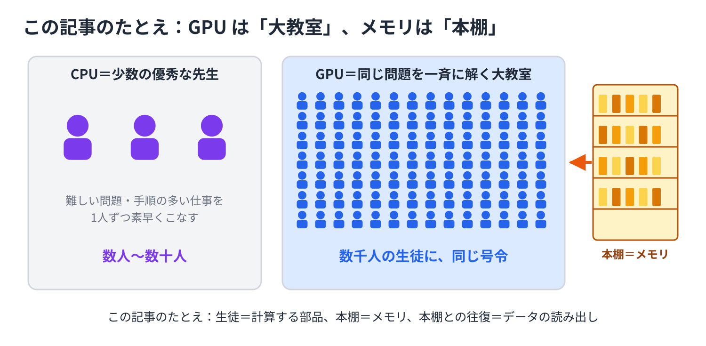
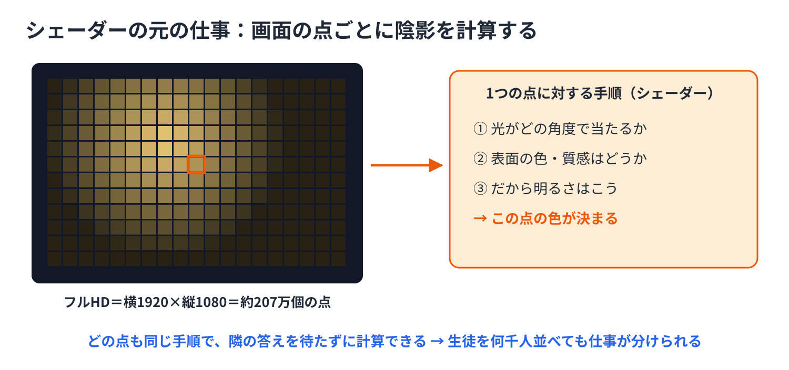
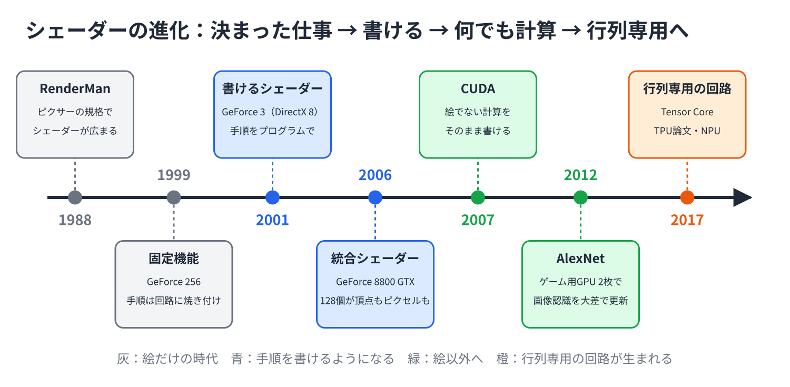
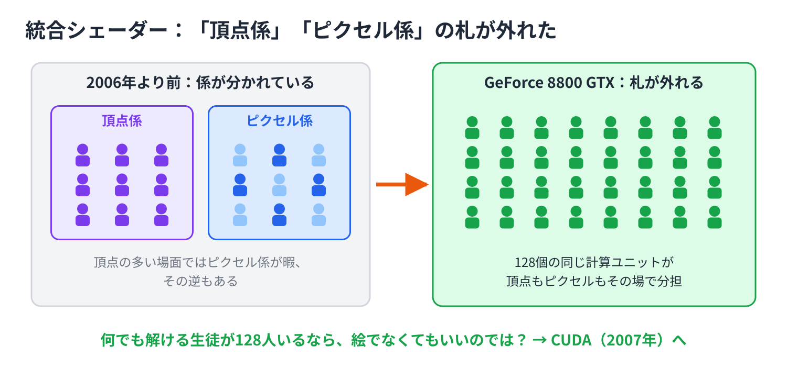
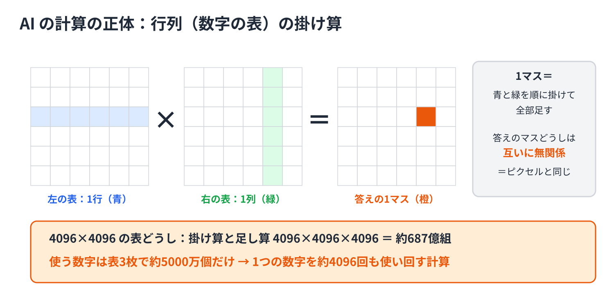
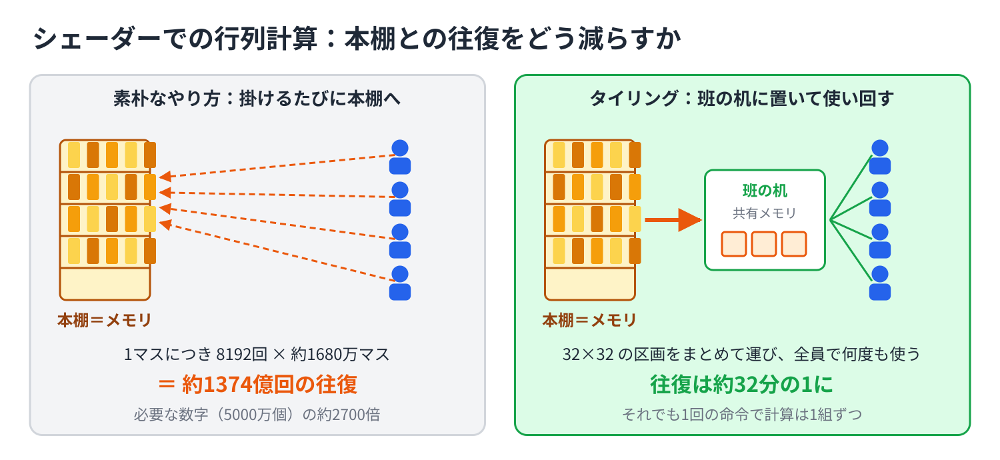
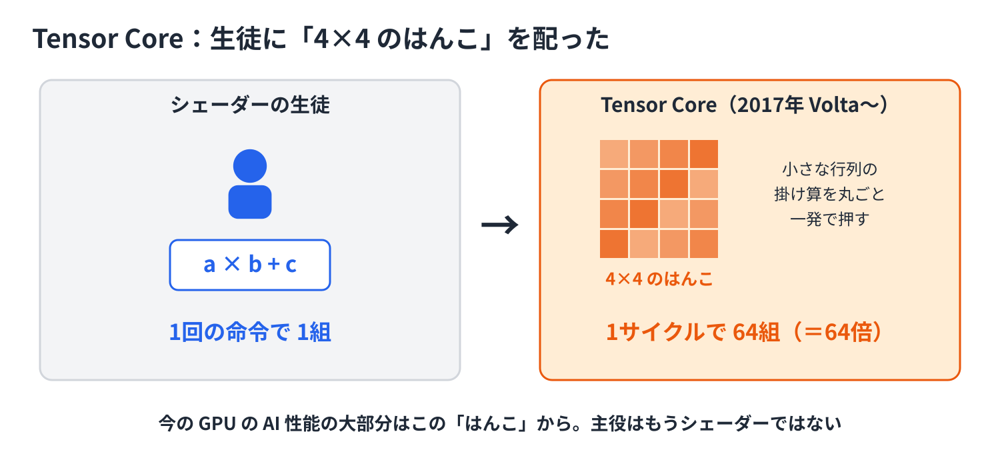
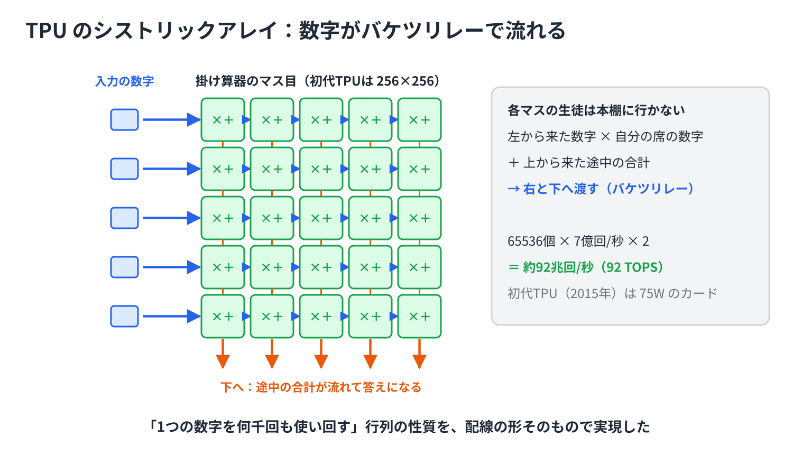
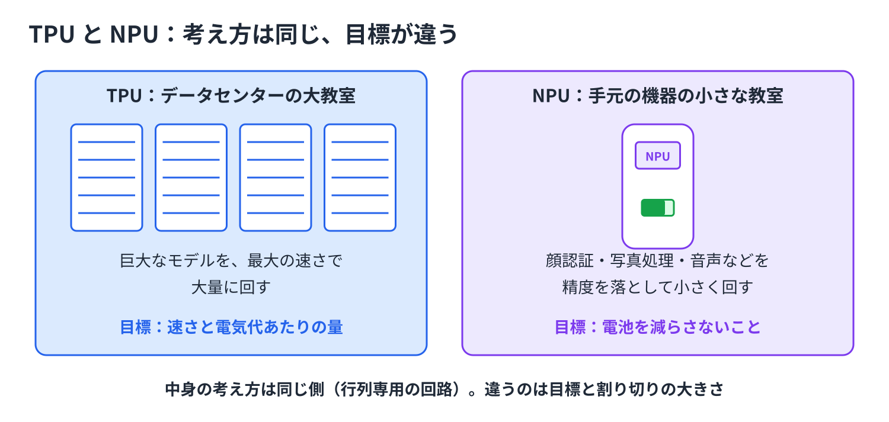
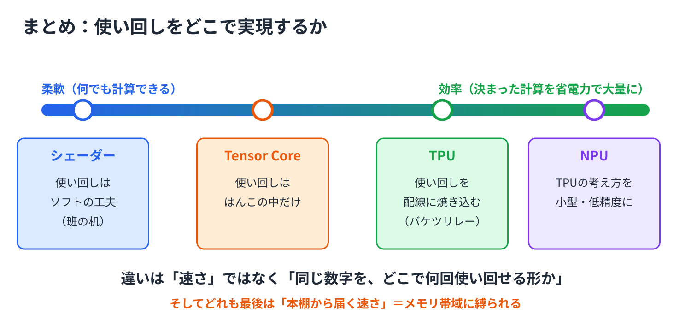

# 絵を描く部品は、なぜ AI の主役になったのか

シェーダーとは何か、どう進化したか、行列をどう計算しているか、TPU・NPU と何が違うのか。
`explainer-script` スキルで書いた記事版の例です（イラスト10枚つき・図は `img/`、生成元は同じ名前の `.svg`）。

## 「影をつける係」が、なぜ AI の計算をしているのか？

シェーダーとは、もともと**画面に陰影をつけるための小さなプログラム**です。名前の shade は「陰影をつける」という意味です。この言葉が広まったのは、ピクサーが1988年に定めた描画の規格 RenderMan からでした。CG 映画で物の表面の光り方を決めるプログラムを、シェーダーと呼んでいたんです。

ところが今、ChatGPT のような AI を学習させたり動かしたりしているのは、そのシェーダーを積んだ GPU です。絵を描く部品が、なぜ文章を書く AI の計算に向いていたのでしょうか。

もう一つ妙なことがあります。最新の GPU で AI の計算を実際にこなしているのは、**じつはシェーダーではありません**。

この二つの謎を順に追います。

## そもそも、シェーダーは何をしていたのか？

ここからは、GPU を**大きな教室**にたとえます。机に座っているのが計算する生徒で、教室の後ろの本棚がメモリです。

画面は小さな点、ピクセルの集まりです。フルHDなら横1920×縦1080で、約207万個あります。その一つひとつについて「光がこの角度で当たるから、この明るさ」と色を計算するのがピクセルシェーダーの仕事です。

ポイントは、**どのピクセルも同じ手順で、しかもお互いに無関係に計算できる**ことです。隣のピクセルの答えを待つ必要はありません。だから生徒を何百人、何千人と並べて、「全員、同じ手順で自分の担当の点を計算して」と号令をかければ済みます。CPU が少数の優秀な先生だとすれば、GPU は「同じ計算問題を一斉に解く大教室」です。

## 最初から、なんでも計算できたのか？

いいえ。最初は計算の手順を変えられませんでした。1999年の GeForce 256 までの GPU は、光の当て方の計算が回路に焼き付けてある「固定機能」でした。生徒は決まった問題しか解けなかったわけです。

これが2001年の GeForce 3（DirectX 8 対応）で変わります。頂点やピクセルを処理する手順を、開発者がプログラムとして書けるようになりました。これが現在の意味でのシェーダーです。

ただ、まだ教室は二つに分かれていました。頂点を計算する生徒とピクセルを計算する生徒が別々で、場面によってどちらかが暇になります。

そこで2006年11月の GeForce 8800 GTX が、**統合シェーダー**を採用します。128個の同じ計算ユニットが、頂点もピクセルもその場で分担します。生徒の席から「頂点係」「ピクセル係」という札が外れたんです。

そして札が外れたことで、ある問いが生まれます。どんな問題でも解ける生徒が128人いるなら、**別に絵でなくてもいいのでは？**

## 絵ではない計算を、どうやって GPU にやらせたのか？

じつは2000年代前半から、研究者は GPU を「だまして」使っていました。計算したい数値を画像の色に見立てて、シェーダーに渡すんです。スタンフォード大学の Ian Buck たちは、それを普通のプログラムとして書ける言語 Brook を作りました。

Buck はその後 NVIDIA に移り、2007年に CUDA を世に出します。画像に見立てるごまかしをせずに、GPU の生徒全員にどんな計算でも号令できる仕組みです。グラフィックスと汎用計算の橋を、一人の研究者がつないだことになります。

その5年後の2012年、画像認識の AlexNet が、ゲーム用 GPU の GTX 580 を2枚使って学習され、それまでの手法を大差で破りました。ここから AI と GPU の結びつきが一気に強まります。

では、なぜ AI の計算がこれほど GPU に合ったのでしょうか。

## AI の計算の正体は何か？

AI の計算は、ほとんどが**行列の掛け算**です。行列は数字を縦横に並べた表です。表と表を掛けると、答えの表の1マスは「左の表の1行」と「右の表の1列」を掛けて足し合わせた値になります。

そして、**答えのマスどうしは互いに無関係**です。ピクセルと同じですよね。だからシェーダーの教室では、生徒1人に答えのマスを1つずつ担当させればよいわけです。

ここで計算してみます。4096×4096の行列どうしの掛け算です。答えのマスは4096×4096で約1680万個あり、1マスにつき4096回の掛け算と足し算が要ります。4096 × 4096 × 4096 で、掛け算と足し算は**約687億組**になります。

一方、使う数字そのものは、表3枚分で約5000万個しかありません。つまり、**同じ数字を一つにつき約4096回も使い回す**計算なんです。この「使い回し」が、この先ずっと鍵になります。

## では、シェーダーは行列をどう計算していたのか？

素直にやると、生徒は掛け算のたびに本棚まで数字を取りに行きます。1マスにつき行の4096個と列の4096個で、計8192回です。それが1680万マスあるので、本棚への往復は**約1374億回**になります。必要な数字は5000万個しかないのに、その約2700倍も往復しているわけです。生徒の手は速いのに、本棚の前の行列で待っている時間のほうが長くなります。

そこで GPU のプログラマーは、**班ごとの共有の机**を使う工夫をしました。GPU には「共有メモリ」という、班の中で共有できる小さくて速い置き場があります。表を32×32の小さな区画に切り、班でまとめて本棚から運んで机に置き、そこから全員で何度も使い回します。こうすると本棚への往復は約32分の1に減ります。この技法をタイリングと呼び、GPU で行列を速く計算するための基本の型になりました。

それでも、ここには限界があります。シェーダーの生徒は1回の命令で、掛け算と足し算を**1組しか**できないんです。どんなに机を工夫しても、手の動きそのものは1組ずつです。

## 最新の GPU は、何が変わったのか？

ここで冒頭の二つ目の謎が解けます。2017年、NVIDIA は Volta 世代の V100 に **Tensor Core** という部品を入れました。

Tensor Core は「4×4の小さな行列の掛け算」を丸ごと1回でこなす専用の回路です。NVIDIA の Volta の技術資料によると、1サイクルで掛け算と足し算を**64組**こなします。シェーダーの生徒が1組ずつなのに対して、64倍です。生徒に、4×4の掛け算表を一発で押せる「はんこ」を配ったようなものです。

今の GPU が AI で出す性能の大部分は、このはんこから来ています。つまり **AI の計算の主役は、もうシェーダーではなく Tensor Core** です。シェーダーは、その周りの細かい処理を受け持つ側に回りました。

ということは、GPU は自分の中に「行列専用の装置」を取り込んだわけです。では、最初から行列専用に作った TPU は何が違うのでしょうか。

## TPU は、教室のどこが違うのか？

TPU は**教室の作りそのものが違います**。

Google が2017年の学会 ISCA で発表した初代 TPU の論文によると、心臓部は256×256のマス目に並べた**6万5536個の掛け算器**です。これを「シストリックアレイ」と呼びます。

このマス目の生徒は、本棚に行きません。左隣から受け取った数字に、自分の席に置いてある数字を掛け、上から来た途中の合計に足して、右と下へ渡します。それを全員がいっせいに、心臓の鼓動のようなリズムで繰り返します。**バケツリレー**です。

本棚から出た数字は、マス目の端から入ると、256人の手を順に渡っていきます。さっき見た「一つの数字を何千回も使い回す」という行列の性質を、**配線の形そのもので実現した**わけです。共有の机をソフトの工夫で使い回す必要がありません。

これも計算してみます。掛け算器6万5536個が700MHzで動くと、1秒に6万5536 × 7億回です。掛け算と足し算を2回の計算と数えると、**約92兆回／秒**になり、論文の 92 TOPS と一致します。しかもこの初代 TPU は、消費電力75Wのカードでした。家庭用の電球1個ほどの電力です。

## では NPU は？

NPU は、スマートフォンやパソコンに入っている「AI 専用部」の総称です。2017年の iPhone X に載った Apple A11 の Neural Engine が、よく知られた初期の例です。

中身の考え方は TPU と同じ側にあります。行列の掛け算を、電力あたりで効率よくこなす専用回路です。違うのは目標です。データセンターの TPU は巨大なモデルを最大限の速さで回すことを、NPU は**バッテリーを減らさずに**顔認証や写真処理を回すことを狙っています。そのため、扱う数字の精度を8ビット以下に落としたり、小さなモデル専用にしたりと、割り切りがより大きくなります。

| 装置 | 教室のたとえ | 行列の計算のしかた | 得意なこと |
|---|---|---|---|
| シェーダー | 何でも解ける生徒の大教室 | 1人1マス、1回に1組。机の使い回しはソフトの工夫 | 何でも柔軟に |
| Tensor Core | 生徒に4×4のはんこ | 小さな行列を1回で | GPU の柔軟さを保ったまま行列を高速に |
| TPU | バケツリレーのマス目 | 数字が隣へ流れ、本棚に戻らない | 大きな行列を大量に・省電力で |
| NPU | 小さなリレー教室を電池で | TPU と同じ考え方を小型・低精度に | 手元の機器で、電池を減らさずに |

## なら、全部 TPU にすればいいのでは？

ここで GPU 側の言い分も見ておきます。こちらもかなり強力です。

バケツリレーは、**決まった形の行列掛け算**には無敵です。けれど AI の研究では、毎年のように新しい計算の形が出てきます。注意機構の新しい変種、データの一部だけを使う計算、行列ではない細かい処理などです。そういうものは、何でも解けるシェーダーの生徒がいる GPU で、まず動きます。CUDA には約20年分のソフトの蓄積もあります。

実際、Google 自身も自社の TPU を作りながら、NVIDIA の GPU を大量に買ってクラウドで貸し出しています。専用チップを作った会社でさえ、汎用の教室を手放していないわけです。

そして、どちらにも共通の弱点があります。どれだけ手やはんこやリレーを速くしても、最後は**本棚から数字が届く速さ**、つまりメモリ帯域に縛られます。いわゆる「メモリの壁」です。

## 結局、何が違うのか？

個人的には、シェーダー・Tensor Core・TPU・NPU の違いを「どれが速いか」で見ると、本質を見落とすと思います。

本当の違いは、**同じ数字を何回使い回せる形をしているか**です。シェーダーは生徒が自由な代わりに、使い回しをソフトの工夫に頼っています。Tensor Core は小さなはんこの中だけで使い回します。TPU と NPU は、使い回しを配線そのものに焼き込みました。その代わりに柔軟さを手放しています。

GPU の歴史は、何でも解ける教室に、行列専用の装置を少しずつ取り込んできた歴史です。そして TPU は、その専用装置だけで教室を建てた側です。両者は反対側から出発して、同じ場所に近づいています。

だから、チップの性能表を見るときは、自分で次の3点を確かめるのがおすすめです。

1. **その TOPS は、どの部品の、どの精度の数字か。** シェーダーの数字か Tensor Core の数字か、8ビットか4ビットかで、何倍も変わります。
2. **メモリ帯域はいくつか。** 手が速くても、本棚から届かなければ止まります。
3. **使いたいソフトやモデルが、そのチップで本当に動くか。** 専用チップほど、ここで差が出ます。

---

**主な資料**：ピクサー RenderMan Interface（1988年）／NVIDIA GeForce 3（2001年）・GeForce 8800 GTX（2006年）・Volta の技術資料（2017年）／Ian Buck らの Brook（2004年）・CUDA（2007年）／AlexNet 論文（2012年）／Google の初代 TPU 論文（ISCA 2017年）／Apple A11 Bionic（2017年）。

**未確認**：年号と仕様の数字は筆者の既存知識に基づき、執筆時に原典との照合はしていない。公開・引用の前に原典で確認すること。
